# RentOuts × Mezo — pay rent in MUSD

**Keep your bitcoin. Pay your rent.**

Long-term rent and deposits paid in **MUSD**, Mezo’s Bitcoin-backed dollar, through a non-custodial escrow on Mezo testnet. A tenant borrows MUSD against their BTC inside the app (no selling), prepays the deposit and rent into the escrow, and the escrow releases rent to the landlord one period at a time. At move-out the deposit goes straight back to the tenant.

| | |
|---|---|
| **Live app** | **https://mezo.rentouts.co** (Mezo testnet, one wallet is enough) |
| **Demo video** | **https://youtu.be/AFmjEAp-zj8** (1:55, the full loop on testnet) |
| **Existing product** | https://rentouts.co — long-term rental marketplace (6–24 month homes, not nightly stays) |
| **Buildathon** | Mezo Buildathon, Wave 1 · Track 2: Access and Distribution |
| **Chain** | Mezo testnet, chain id 31611 · gas in BTC · MUSD `0x1189…c503` |
| **Contracts** | Verified on Sourcify (exact match) · 104 Foundry tests incl. an invariant suite · 117 app tests |
| **Team** | AiAlchemist · X [@RentOuts](https://x.com/RentOuts) |

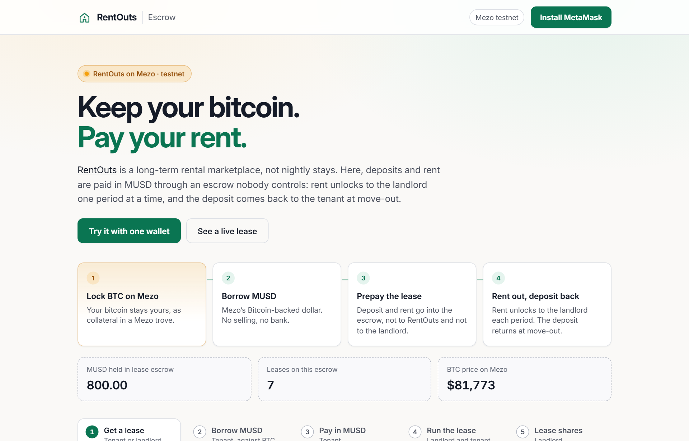

---

## Contents

- [Demo video](https://youtu.be/AFmjEAp-zj8) (1:55)
- [The problem](#the-problem)
- [What we built](#what-we-built)
- [Try it in five minutes](#try-it-in-five-minutes)
- [How it works](#how-it-works) — system map, one lease end to end, lease states
- [How MUSD and Mezo are used](#how-musd-and-mezo-are-used)
- [Screenshots](#screenshots)
- [Contracts and live evidence](#contracts-and-live-evidence)
- [Security model](#security-model)
- [Limitations](#limitations)
- [Roadmap](#roadmap)
- [Repository map](#repository-map)
- [Build, test, deploy](#build-test-deploy)

---

## The problem

A long-term lease puts one side at the other’s mercy.

- **Renters** hand a deposit to the landlord’s bank and hope to see it again. Small-claims court is often the only door.
- **Owners** chase late rent, bounced payments and reversals months later. Two spreadsheets, no shared ledger.
- **Bitcoin holders** pay the biggest bill they have, rent, in dollars. Today that means selling BTC, with the tax event that comes with it.

## What we built

RentOuts is an existing, invite-only long-term rental marketplace at [rentouts.co](https://rentouts.co): owners list, renters search and inquire, both sign in with Ethereum. For the Mezo Buildathon we added the piece that makes the lease fair to both sides, paid in a Bitcoin-backed dollar:

1. **RentEscrow on Mezo with MUSD as its token.** The tenant prepays the deposit and every period’s rent. Rent unlocks to the landlord period by period; the landlord can never take it early and the tenant can never be late. At the end the deposit returns to the tenant. No admin keys, no fee, not upgradeable. RentOuts never holds funds.
2. **Borrow MUSD against BTC, in the app.** The Borrow step calls Mezo Borrow directly (`openTrove` for a new trove, `withdrawMUSD` for an existing one) and shows the BTC price, collateral ratio, fee and liquidation price before the tenant signs. It sizes a new trove to the wallet: Mezo’s testnet faucet BTC is enough on the first try.
3. **DemoLandlord.** A contract landlord anyone can rent from, so a reviewer can run the whole tenant side with a single wallet.
4. **A hosted app** at https://mezo.rentouts.co with live on-chain stats, a lease that keeps releasing rent through judging, and a mobile layout.

## Try it in five minutes

You need a browser wallet (MetaMask) on Mezo testnet; the app offers to add and switch the network.

1. Get testnet BTC from **https://faucet.test.mezo.org** (0.05 BTC covers everything below).
2. Open **https://mezo.rentouts.co** → **Get a lease** → *Get a demo lease*. The demo landlord creates a lease with you as the tenant: a 20 MUSD deposit and 3 × 10 MUSD rent, one period a minute.
3. **Borrow MUSD** → the app suggests Mezo’s 1,800 MUSD minimum at the safest ratio your BTC allows → *Borrow*. Your BTC stays yours, locked in your own Mezo trove.
4. **Pay in MUSD** → *Approve 50.00 MUSD* → *Pay rent in MUSD — Bitcoin-backed*.
5. **Run the lease** → after a minute, *Release rent* (anyone may; it only ever goes to the landlord). After the term plus one period, *Close lease*: the 20 MUSD deposit comes back to you.

No wallet? **Run the lease** shows lease #2 (800 MUSD prepaid, 50 MUSD released per day until 6 Nov 2026) live from the chain.

## How it works

### System map

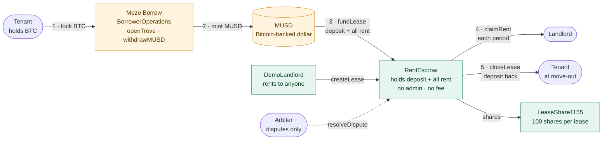

The app at mezo.rentouts.co reads Mezo’s price feed and trove data, and every transaction is signed in the user’s own wallet.

### One lease, end to end

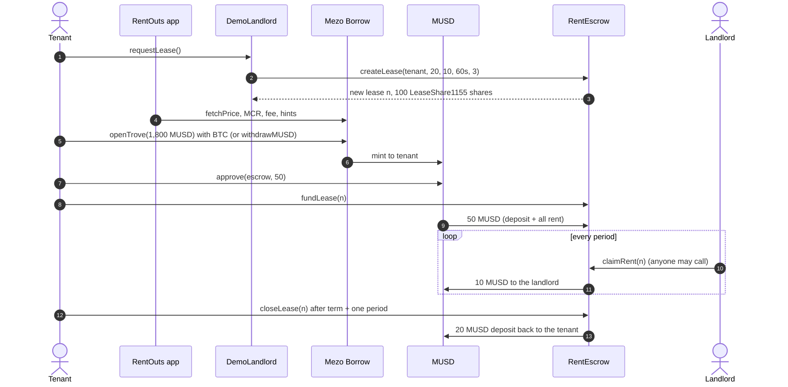

### Lease states

```mermaid
stateDiagram-v2
    [*] --> CREATED: createLease (landlord)
    CREATED --> CANCELLED: cancelLease (landlord, before funding)
    CREATED --> ACTIVE: fundLease (tenant prepays deposit + all rent)
    ACTIVE --> ACTIVE: claimRent (anyone; rent only to the landlord)
    ACTIVE --> CLOSED: closeLease (after the term; rest of rent to landlord, deposit to tenant)
    ACTIVE --> DISPUTED: openDispute (tenant or landlord)
    DISPUTED --> CLOSED: resolveDispute (arbiter splits what is left)
    CLOSED --> [*]
    CANCELLED --> [*]
```

After the term, the landlord can close at once; anyone else can close one period later. That grace period is the landlord’s window to open a dispute (for example over damage) before the deposit goes back.

## How MUSD and Mezo are used

| Step | Contract call | Why it matters |
|---|---|---|
| Borrow | `BorrowerOperations.openTrove(debt, upperHint, lowerHint)` with BTC as value, or `withdrawMUSD(amount, …)` on an existing trove | The tenant gets MUSD without selling BTC. Each new tenant who borrows opens a Mezo Borrow position. |
| Borrow (reads) | `PriceFeed.fetchPrice`, `MCR`, `CCR`, `minNetDebt`, `borrowingRate`, `MUSD_GAS_COMPENSATION`, `TroveManager.getEntireDebtAndColl` | Price, ratio, fee and liquidation price are shown before signing; the default is sized to the wallet’s BTC. |
| Borrow (hints) | `HintHelpers.computeNominalCR` + `getApproxHint` → `SortedTroves.findInsertPosition` | Keeps the trove insert cheap; falls back to zero hints if the lookup fails. |
| Pay | `MUSD.approve` → `RentEscrow.fundLease` | Deposit plus every period’s rent are held in MUSD for the whole term. |
| Run | `RentEscrow.claimRent` · `closeLease` | MUSD flows to the landlord per period and back to the tenant at the end. |

Why rent is a good use of MUSD: it is the largest recurring bill most people pay, and every lease holds MUSD for months. One $2,000-a-month, 12-month lease is 26,000 MUSD held in escrow on day one and released over a year.

## Screenshots

| 1 · Get a lease from the demo landlord | 2 · Borrow MUSD against BTC |
|---|---|
| 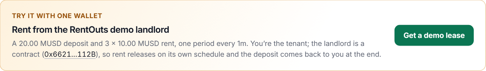 | 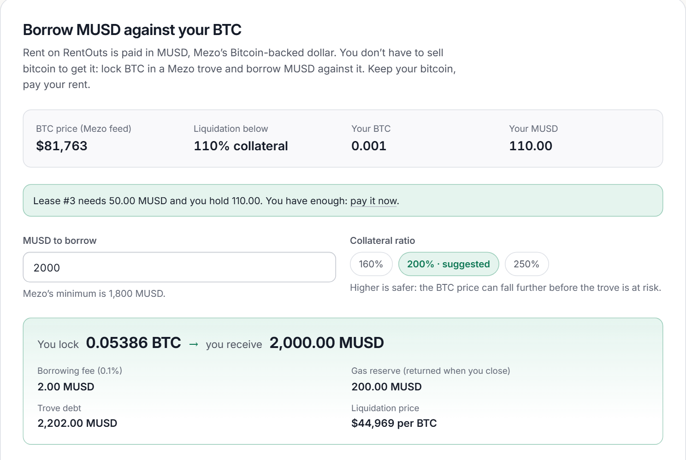 |

| 3 · Pay deposit + rent in MUSD | 4 · Rent released, deposit back |
|---|---|
| 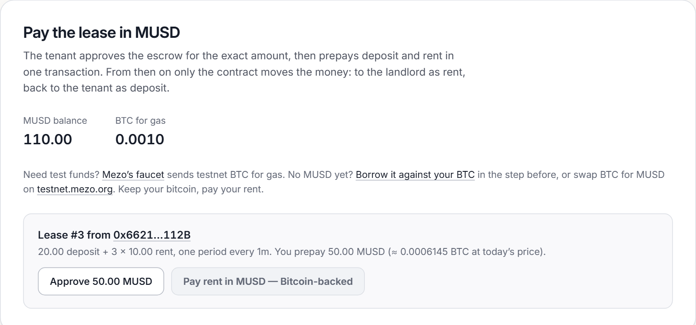 | 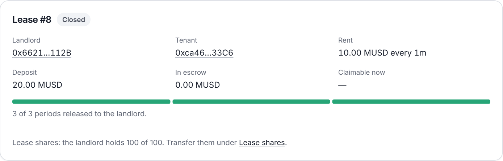 |

| A lease releasing rent during judging | Every step on the Mezo explorer |
|---|---|
| 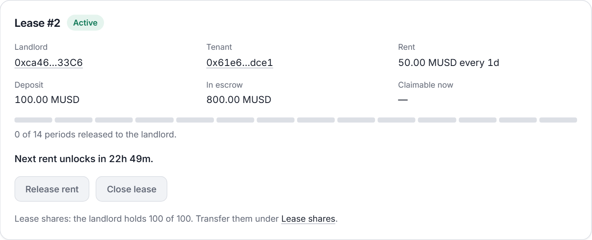 | 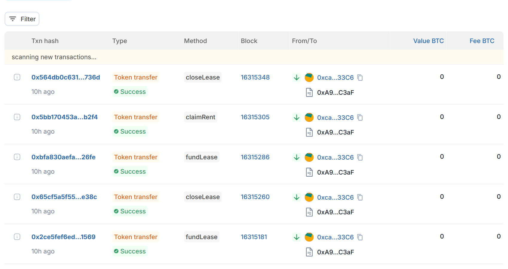 |

<p align="center">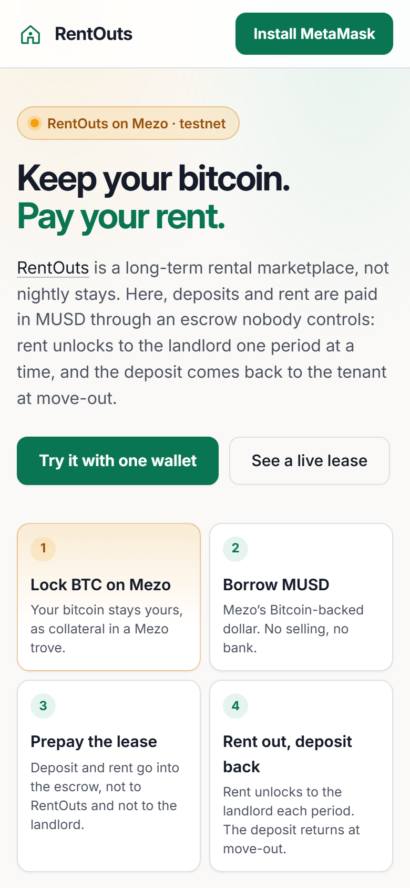</p>

## Contracts and live evidence

All on Mezo testnet (chain 31611), verified on Sourcify (exact match).

| Contract | Address | Role |
|---|---|---|
| RentEscrow | [`0xA9f09366991E6df87855F4B99025911790d4C3aF`](https://explorer.test.mezo.org/address/0xA9f09366991E6df87855F4B99025911790d4C3aF) | Holds deposit + rent in MUSD; releases rent per period |
| LeaseShare1155 | [`0xfE8bF13ed62A473277d841b0DEDf7720C3DBc820`](https://explorer.test.mezo.org/address/0xfE8bF13ed62A473277d841b0DEDf7720C3DBc820) | ERC-1155 lease shares (100 per lease, compliance allowlist) |
| DemoLandlord | [`0x6621dE90776302aD1a3C0190141f9169B4A0112B`](https://explorer.test.mezo.org/address/0x6621dE90776302aD1a3C0190141f9169B4A0112B) | Rents to anyone: 20 MUSD deposit, 10 MUSD / 60 s × 3 |
| Arbiter | `0x1da334A5FaB59a741fDAE7f081c7f592027b3106` | Can only split a disputed lease between its two parties |
| MUSD (Mezo) | `0x118917a40FAF1CD7a13dB0Ef56C86De7973Ac503` | Settlement token, 18 decimals |
| BorrowerOperations (Mezo) | `0xCdF7028ceAB81fA0C6971208e83fa7872994beE5` | `openTrove` / `withdrawMUSD` |

**Lease #6 — the full flow from the live site** (demo lease → borrow in-app → pay → release → close):

| Step | Tx |
|---|---|
| DemoLandlord.requestLease | [`0x5d250a56…6c4e`](https://explorer.test.mezo.org/tx/0x5d250a56d0df12add7416852a1f8a5b8862f093cc1a2caf67ac5f77765ed6c4e) |
| BorrowerOperations.withdrawMUSD | [`0x20654b72…c97c`](https://explorer.test.mezo.org/tx/0x20654b722b6c333a59cabe5ca19f772753152c946043f619d5609638204ec97c) |
| MUSD.approve | [`0x2efcf493…d4f9`](https://explorer.test.mezo.org/tx/0x2efcf493db6717f081054bf22406d3c412875c522fece6488895a9f858ecd4f9) |
| RentEscrow.fundLease | [`0xed3097f3…28aa`](https://explorer.test.mezo.org/tx/0xed3097f36a3898811192d5f0f5f6220b5d95b75eaa66918ef13491508c1c28aa) |
| RentEscrow.claimRent | [`0x6a684a83…a021`](https://explorer.test.mezo.org/tx/0x6a684a831177a4bef4d524e68d63fcb5e2c67c3102e38b40d44d2b61c35da021) |
| RentEscrow.closeLease | [`0xc462a321…ae77`](https://explorer.test.mezo.org/tx/0xc462a3219e08f85912ebe0a0a334eca7cc6a1f5edb9788138d99aebfe85cae77) |

**Lease #1** — first MUSD lease, minted through `openTrove` (2,000 MUSD on 0.045 BTC): [`openTrove`](https://explorer.test.mezo.org/tx/0x037283b2380752c8ce1c58df1a11ebd0e2a3c8b8ca3316d2b50905ef5466917b) · [`createLease`](https://explorer.test.mezo.org/tx/0x5c8199923d447762e3328682c0018834a393ba369b8932d6b513f751184a92ed) · [`fundLease`](https://explorer.test.mezo.org/tx/0x3bd42097117b0277f2d44e90bcc07ab757c0c1e5c0d95fbd49995602eaa89690) · [`claimRent`](https://explorer.test.mezo.org/tx/0xe3dddf8d66a9a19c3fe675b2ce524a230a33c34b951409ea6394645db63302ef) · [`closeLease`](https://explorer.test.mezo.org/tx/0x0ca9fcd7661273512c8fffd0a708d51a817a0fe6878e4ef4396c62eb1cb71c87)

**Lease #2** — running until 6 Nov 2026: 100 MUSD deposit, 50 MUSD / day × 14, 800 MUSD prepaid ([`createLease`](https://explorer.test.mezo.org/tx/0x2f0dd40f50ad94a28935af4acdc7802d59fd28bfa3df51a1d1d40a960ce7c9f7) · [`fundLease`](https://explorer.test.mezo.org/tx/0xd1d5088b7956bee94ce8ca5bc85a38ff4e63fcb3e5c0bca00b0f7ba00b116532)). Read it live with `getLease(2)` and `claimable(2)`.

Full transaction log: [docs/MEZO-DEMO.md](docs/MEZO-DEMO.md).

## Security model

- **No owner, no admin, no fee, no upgrade path.** Token, arbiter, lease-share contract and human gate are immutable constructor arguments.
- **Funds only ever reach the lease’s two parties.** The arbiter cannot be a landlord or tenant and can only split a disputed lease’s own remaining escrow.
- **Invariants, fuzzed** (`test/RentEscrow.invariant.t.sol`, 64 runs × depth 256, revert = failure):
  - INV-1 funds only ever move to the lease’s tenant or landlord;
  - INV-2 the sum of every lease’s escrow balance equals the escrow’s MUSD balance;
  - INV-3 rent released never exceeds rent per period × elapsed periods (capped at the term);
  - INV-4 a dispute pays out exactly the lease’s remaining escrow.
- **Rent can’t be taken early or withheld.** `claimRent` releases only elapsed periods, and anyone may call it, but the MUSD only goes to the landlord.
- **The app holds no keys.** It is a static site; every transaction is signed in the user’s wallet, simulated first so reverts show as readable messages.

## Limitations

**Getting MUSD takes real BTC.** Mezo’s minimum trove is 1,800 MUSD (plus a 0.1% fee and a 200 MUSD gas reserve that comes back when the trove closes). At about $81k per BTC that needs roughly 0.037 BTC at 150% and 0.049 BTC at 200%: about $3,000–4,000 of BTC, even for a small lease. Mezo’s testnet faucet gives 0.05 BTC, which the app sizes for. Mezo charges 1% a year on the trove. Already holding MUSD skips all of this.

**The whole lease is prepaid.** `RentEscrow` takes the deposit and every period’s rent in one transaction. That is what makes rent impossible to miss for the landlord, but a 12-month, $2,000 lease means 26,000 MUSD up front (about 0.64 BTC at 200%).

**The tenant carries the BTC price risk, the landlord does not.** The BTC is in the tenant’s own Mezo trove, not in the escrow: RentOuts and the landlord cannot touch it, and the tenant can repay and withdraw it at any time. What protects the landlord is the MUSD already in escrow. If BTC falls far enough, the tenant’s trove can be liquidated or redeemed against, but the lease keeps paying the landlord.

**Breaking a lease goes through a dispute.** There is no mutual early termination yet. A tenant who moves out early, a landlord who needs the unit back, or a unit that is not as promised: either side opens a dispute, which freezes what is left in escrow until the arbiter splits it. Rent already released stays released; damage beyond what is left in escrow is not covered on-chain. A dispute has no timeout, so the arbiter must stay available (one key on testnet; a multisig is planned).

**Local rules on deposits and prepaid rent vary.** Some jurisdictions cap deposits or prepaid rent, or require deposits held in trust with interest. A production lease has to fit the local rules; this testnet escrow does not check them.

**Testnet, not audited.** No real funds, no external audit yet. `DemoLandlord` exists only so one wallet can try the tenant side.

## Roadmap

| When | Milestone |
|---|---|
| **Wave 2 · by 15 Nov 2026** | Pay monthly instead of prepaying the whole term (deposit plus the next period, topped up as it goes) · mutual early termination with an agreed penalty · a dispute timeout · borrow-and-pay in one transaction |
| **Q1 2027** | MUSD as a payment option in the rentouts.co owner and renter portals for invite-only beta leases |
| **Q2 2027** | External audit, Mezo mainnet launch, multisig arbiter |

## Repository map

```
rentouts-musd/
├── src/
│   ├── RentEscrow.sol          escrow: create · fund · claimRent · close · dispute
│   ├── LeaseShare1155.sol      ERC-1155 lease shares with a compliance allowlist
│   ├── DemoLandlord.sol        a landlord anyone can rent from (one-wallet demo)
│   ├── HumanGate.sol           optional "verified human" gate for funding (off on Mezo)
│   └── interfaces/             IRentEscrow (lifecycle + invariants), IHumanGate
├── test/                       104 Foundry tests, incl. RentEscrow.invariant.t.sol
├── script/                     DeployEscrow.s.sol, DeployDemoLandlord.s.sol
├── deployments.json            live addresses ("mezoTestnet")
├── .mezo/                      Mezo protocol ABIs + a raw eth_call helper
├── app/                        the web app (React 19, Vite, wagmi + viem)
│   └── src/
│       ├── panels/             Get a lease · Borrow · Pay · Run · Lease shares
│       ├── lib/trove.ts        Mezo Borrow math (ratio, collateral, liquidation, sizing)
│       └── abi/mezo.ts         Mezo Borrow ABIs and addresses
└── docs/                       MEZO-DEMO.md (tx log), img/ (screenshots)
```

## Build, test, deploy

Contracts ([Foundry](https://book.getfoundry.sh/)):

```bash
forge install
forge test                     # 104 tests, including the invariant suite
```

App:

```bash
cd app
npm install
npm test                       # 117 tests: trove math, receipts, deployments, copy
npm run dev                    # http://localhost:5173 (Mezo testnet by default)
npm run build                  # static output in app/dist
```

Deploy the escrow with a Foundry keystore (never a raw private key):

```bash
ESCROW_TOKEN=0x118917a40FAF1CD7a13dB0Ef56C86De7973Ac503 \
ESCROW_ARBITER=<arbiter-address> \
ESCROW_HUMAN_GATE=none \
forge script script/DeployEscrow.s.sol --profile mezo --rpc-url mezo_testnet \
  --account <keystore-name> --sender <deployer-address> --broadcast
```

`ESCROW_HUMAN_GATE=none` leaves funding ungated on this escrow (a gate cannot be added later). A successful broadcast adds a `mezoTestnet` entry to `deployments.json`; the `baseSepolia` key in that file is a placeholder used by the script’s tests, not a live deployment.

Deploy the demo landlord, then allowlist it on LeaseShare1155 once (creating a lease mints its shares to the landlord):

```bash
ESCROW=<RentEscrow address> forge script script/DeployDemoLandlord.s.sol --profile mezo --rpc-url mezo_testnet \
  --account <keystore-name> --sender <deployer-address> --broadcast
# then, as the LeaseShare1155 owner: setAllowlist(<DemoLandlord>, true)
```

The app is a static build served by a Cloudflare Worker (`app/wrangler.jsonc`); it reads every address from `deployments.json` at build time and holds no secrets.

## License

MIT. OpenZeppelin Contracts v5.1.0 is included as a library under its own license.
