# RentOuts × Mezo — pay rent in MUSD

**Keep your bitcoin. Pay your rent.**

Long-term rent and deposits paid in **MUSD**, Mezo’s Bitcoin-backed dollar, through a non-custodial escrow on Mezo testnet. A tenant pays the deposit and rent into the escrow straight from their own Mezo trove, without selling BTC: one signed message can open the trove, borrow the MUSD and pay the lease in a single transaction. The lease can be prepaid in full or paid month by month, and the escrow releases rent to the landlord one period at a time. At move-out the deposit goes straight back to the tenant.

| | |
|---|---|
| **Live app** | **https://mezo.rentouts.co** (Mezo testnet, one wallet is enough) |
| **Pitch deck** | [docs/RentOuts-Mezo-Wave2.pdf](docs/RentOuts-Mezo-Wave2.pdf) (10 slides, Wave 2) · [Wave 1 deck](docs/RentOuts-Mezo-Wave1.pdf) |
| **Demo video** | Wave 2 (2:03, one-signature borrow-and-pay, pay monthly from the trove, Your trove): link coming · Wave 1: https://youtu.be/AFmjEAp-zj8 (1:55) |
| **At a glance** | [Five slides](#at-a-glance): the pitch, Mezo integration, one lease end to end, your trove, trust |
| **Existing product** | https://rentouts.co — long-term rental marketplace (6–24 month homes, not nightly stays) |
| **Buildathon** | Mezo Buildathon · Wave 2 (Wave 1: Track 2, Access and Distribution) |
| **Chain** | Mezo testnet, chain id 31611 · gas in BTC · MUSD `0x1189…c503` |
| **Contracts** | Verified on Sourcify (exact match) · 194 Foundry tests incl. two invariant suites · 163 app tests |
| **Team** | AiAlchemist · X [@RentOuts](https://x.com/RentOuts) |

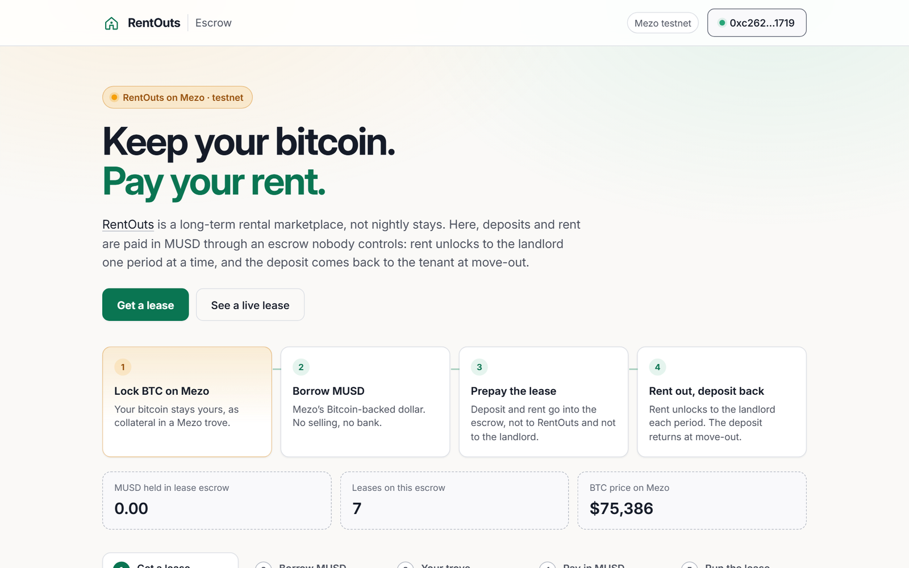

---

## Contents

- Demo video: Wave 2 link coming · [Wave 1](https://youtu.be/AFmjEAp-zj8) (1:55)
- [At a glance](#at-a-glance)
- [The problem](#the-problem)
- [What we built](#what-we-built)
- [Try it in five minutes](#try-it-in-five-minutes)
- [How it works](#how-it-works) — system map, one lease end to end, lease states
- [How MUSD and Mezo are used](#how-musd-and-mezo-are-used)
- [Screenshots](#screenshots)
- [Contracts and live evidence](#contracts-and-live-evidence)
- [Leases on Mezo](#leases-on-mezo)
- [Security model](#security-model)
- [Limitations](#limitations)
- [Business model](#business-model)
- [RentEscrowV2 (Wave 2)](#rentescrowv2-wave-2)
- [Roadmap](#roadmap)
- [Repository map](#repository-map)
- [Build, test, deploy](#build-test-deploy)

---

## At a glance

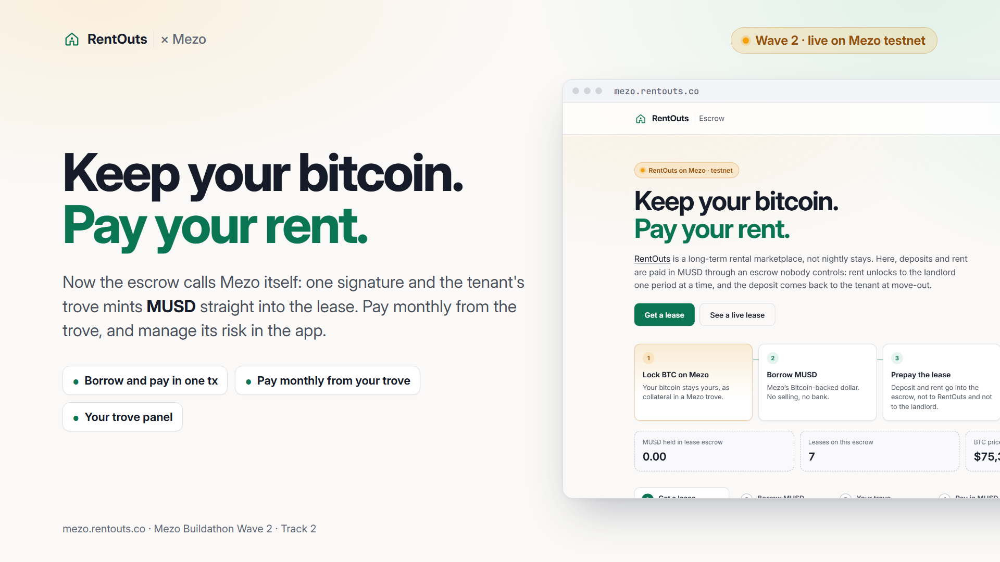

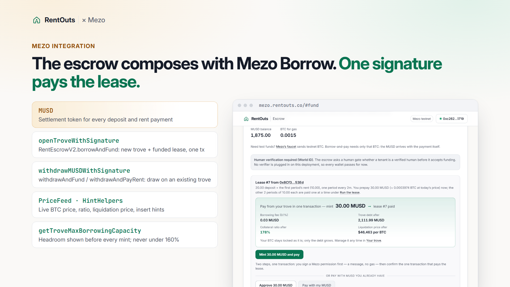

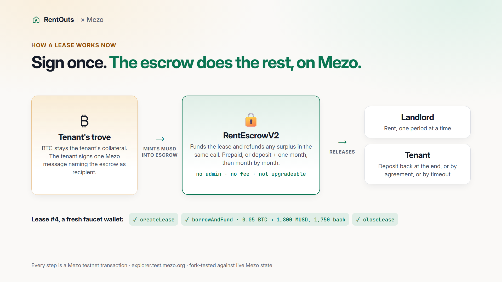

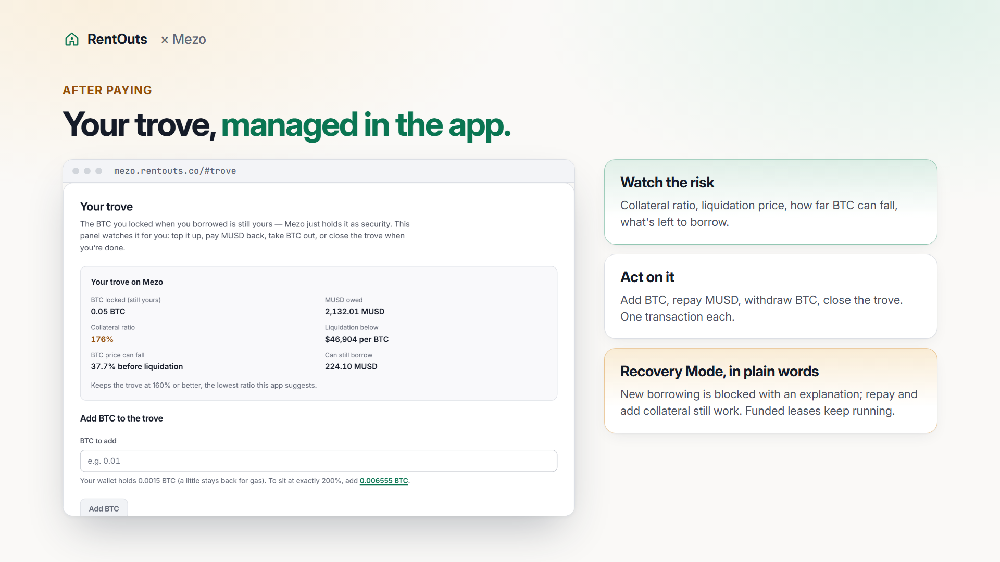

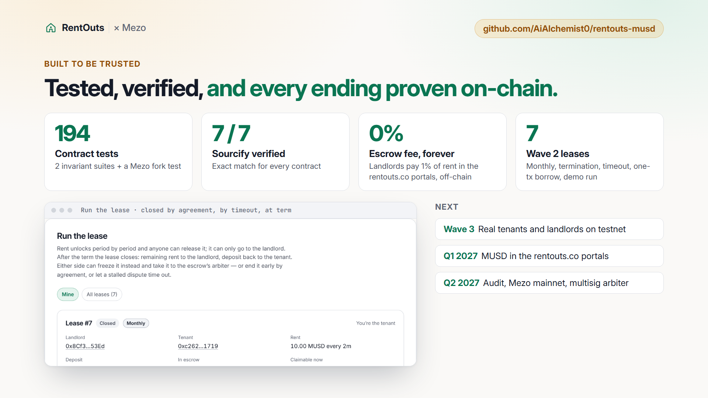

The Wave 1 slides are kept in [docs/gallery/wave1](docs/gallery/wave1).

---

## The problem

A long-term lease puts one side at the other’s mercy.

- **Renters** hand a deposit to the landlord’s bank and hope to see it again. Small-claims court is often the only door.
- **Owners** chase late rent, bounced payments and reversals months later. Two spreadsheets, no shared ledger.
- **Bitcoin holders** pay the biggest bill they have, rent, in dollars. Today that means selling BTC, with the tax event that comes with it.

## What we built

RentOuts is an existing, invite-only long-term rental marketplace at [rentouts.co](https://rentouts.co): owners list, renters search and inquire, both sign in with Ethereum. For the Mezo Buildathon we added the piece that makes the lease fair to both sides, paid in a Bitcoin-backed dollar:

1. **RentEscrowV2 on Mezo with MUSD as its token.** The tenant funds the deposit and rent into the escrow: every period up front (prepaid), or the deposit plus one period at a time (monthly). Rent unlocks to the landlord period by period; the landlord can never take it early, and every settlement (close, dispute ruling, timeout, agreed early end or default) splits exactly what the lease holds. No admin keys, no fee, not upgradeable. RentOuts never holds funds.
2. **Borrow MUSD against BTC inside the payment.** The tenant signs one Mezo borrow message naming the escrow as recipient; the escrow calls Mezo’s `BorrowerOperationsSignatures` relay itself, and a single transaction opens (or draws on) the tenant’s own trove and pays the lease. The app shows the BTC price, collateral ratio, fee and liquidation price before signing, and sizes a new trove to the wallet: Mezo’s testnet faucet BTC is enough on the first try.
3. **DemoLandlordV2.** A contract landlord anyone can rent from, prepaid or monthly, so a reviewer can run the whole tenant side with a single wallet.
4. **A hosted app** at https://mezo.rentouts.co: live on-chain stats, the **Your trove** tab (ratio, liquidation price, add / repay / withdraw / close), and a mobile layout. Leases made on the Wave-1 escrow stay readable in the same screen.

## Try it in five minutes

You need a browser wallet (MetaMask) on Mezo testnet; the app offers to add and switch the network.

1. Get testnet BTC from **https://faucet.test.mezo.org** (0.05 BTC covers everything below).
2. Open **https://mezo.rentouts.co** → **Get a lease** → *Get a prepaid lease* or *Get a monthly lease*. The demo landlord creates a lease with you as the tenant: a 20 MUSD deposit and 3 × 10 MUSD rent, one period every 120 seconds. Prepaid pays all 50 MUSD in one payment; monthly starts at 30 MUSD (deposit + the first period).
3. **Pay in MUSD** → *Borrow 1,800 MUSD and pay*. The app suggests the amount (Mezo’s 1,800 MUSD minimum, at the safest ratio your BTC allows) and shows the BTC price, collateral ratio, fee and liquidation price before you sign. One signature opens your own Mezo trove and pays the lease with the minted MUSD in a single transaction; any surplus comes straight back. (Have a trove already? *Mint 50 MUSD and pay* does the same against it. Already holding MUSD? *Approve*, then *Pay with my MUSD*.)
4. **Run the lease** → after a period, *Release rent* (anyone may call it; the MUSD only ever goes to the landlord). On a monthly lease, pay each next period with *Pay next period from your trove*. After the term, *Close lease*: the deposit comes back to you.
5. **Your trove** shows your BTC locked (still yours), what you owe, your collateral ratio and the price you’d be liquidated below, and lets you add BTC, repay MUSD, withdraw BTC or close the trove.

No wallet? **Run the lease** reads both escrows live from the chain; [Leases on Mezo](#leases-on-mezo) lists what you will see.

## How it works

### System map

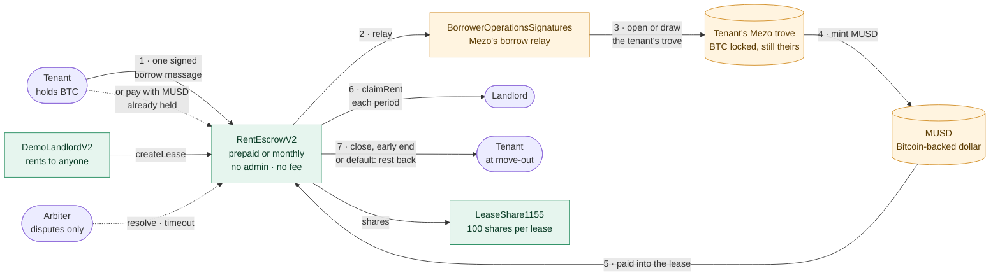

The app at mezo.rentouts.co reads Mezo’s price feed and trove data, and every transaction is signed in the user’s own wallet.

### One lease, end to end

The full loop of a prepaid lease, paid by the one-transaction borrow:

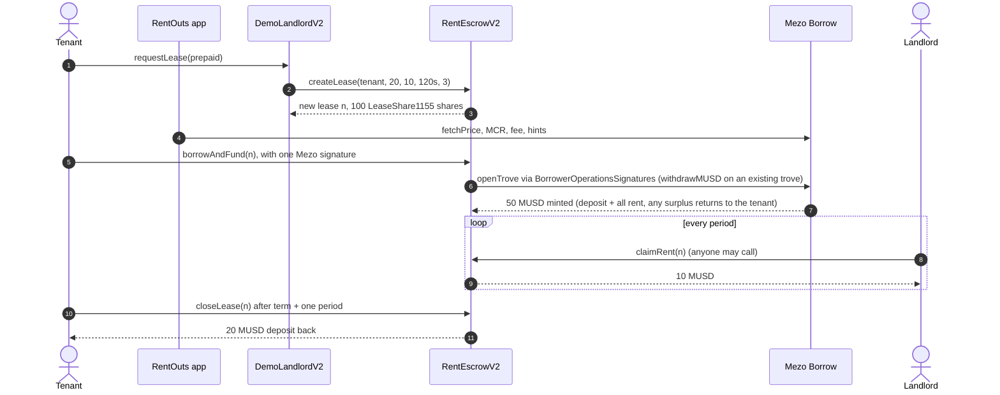

A monthly lease runs on the same clock with the funding split up: `createLeaseMonthly` first, then `borrowAndFund` (or a plain payment) covers the deposit and the first period, and each later period is one signature the escrow relays (`withdrawAndPayRent`) to draw that period’s rent from the tenant’s trove.

### Lease states

```mermaid
stateDiagram-v2
    [*] --> CREATED: createLease · createLeaseMonthly (landlord)
    CREATED --> CANCELLED: cancelLease (landlord, before funding)
    CREATED --> ACTIVE: fundLease or borrowAndFund (prepaid: deposit + all rent · monthly: deposit + first period)
    ACTIVE --> ACTIVE: claimRent (anyone; rent only to the landlord) · payRent on monthly
    ACTIVE --> CLOSED: closeLease · accepted termination · claimDefault (monthly default)
    ACTIVE --> DISPUTED: openDispute (tenant or landlord)
    DISPUTED --> CLOSED: resolveDispute (arbiter) · resolveByTimeout (anyone, after the timeout)
    CLOSED --> [*]
    CANCELLED --> [*]
```

After the term, the landlord can close at once; anyone else can close one period later. That grace period is the landlord’s window to open a dispute (for example over damage) before the deposit goes back. On a monthly lease, a period left unpaid one full period past its due date lets the landlord close by default: they keep the funded rent not yet claimed plus at most one period’s rent from the deposit, and the tenant gets the rest.

## How MUSD and Mezo are used

| Step | Contract call | Why it matters |
|---|---|---|
| Borrow | `BorrowerOperations.openTrove(debt, upperHint, lowerHint)` with BTC as value, or `withdrawMUSD(amount, …)` on an existing trove | The tenant gets MUSD without selling BTC. Each new tenant who borrows opens a Mezo Borrow position. |
| Borrow (reads) | `PriceFeed.fetchPrice`, `MCR`, `CCR`, `minNetDebt`, `borrowingRate`, `MUSD_GAS_COMPENSATION`, `TroveManager.getEntireDebtAndColl` | Price, ratio, fee and liquidation price are shown before signing; the default is sized to the wallet’s BTC. |
| Borrow (hints) | `HintHelpers.computeNominalCR` + `getApproxHint` → `SortedTroves.findInsertPosition` | Keeps the trove insert cheap; falls back to zero hints if the lookup fails. |
| Pay | `MUSD.approve` → `RentEscrowV2.fundLease` (prepaid) or `payRent` (monthly); or one transaction: `borrowAndFund` / `withdrawAndFund` / `withdrawAndPayRent`, with the escrow relaying the tenant’s signed message through Mezo’s `BorrowerOperationsSignatures` | Deposit plus funded rent are held in MUSD in the escrow; the borrow paths mint the MUSD inside the payment itself. |
| Run | `RentEscrowV2.claimRent` · `closeLease` · `proposeTermination` / `acceptTermination` · `resolveByTimeout` · `claimDefault` | MUSD flows to the landlord per period and back to the tenant at the end; an early end, a timed-out dispute or a stopped monthly lease each split exactly what the lease holds. |

Why rent is a good use of MUSD: it is the largest recurring bill most people pay, and a lease holds MUSD for months. A prepaid $2,000-a-month, 12-month lease holds 26,000 MUSD in escrow on day one and releases it over a year; a monthly lease holds one month at a time and still pays the landlord from Bitcoin.

## Screenshots

From the live app on Mezo testnet (Wave 2), signed in as the demo tenant. Wave 1 screenshots are kept in [docs/img/wave1](docs/img/wave1).

| 1 · Get a lease from the demo landlord | 2 · One signature: mint from your trove and pay |
|---|---|
| 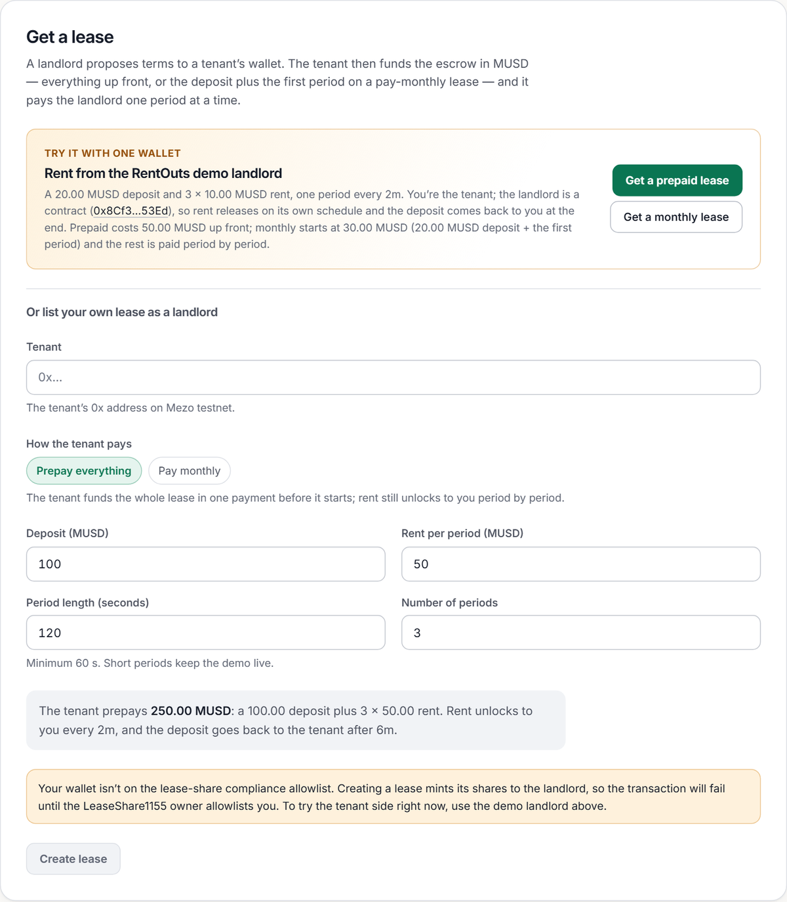 | 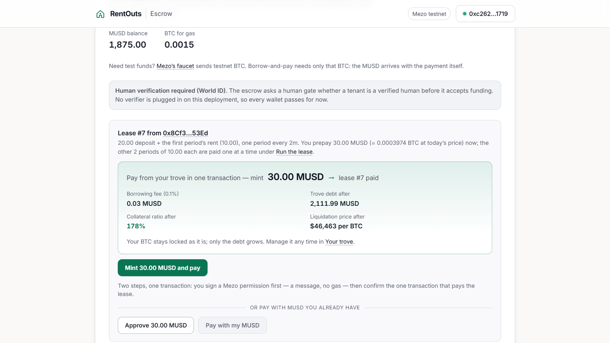 |

| 3 · Your trove: ratio, liquidation price, repay, add or withdraw BTC | 4 · Every lease, run to its end |
|---|---|
| 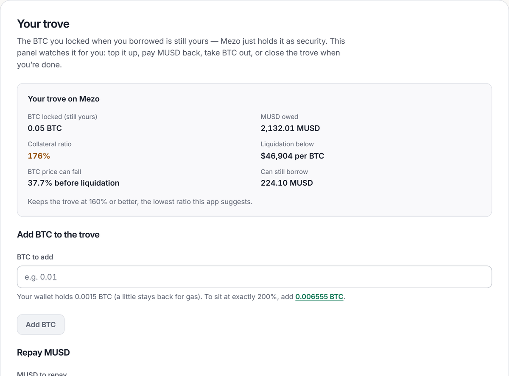 | 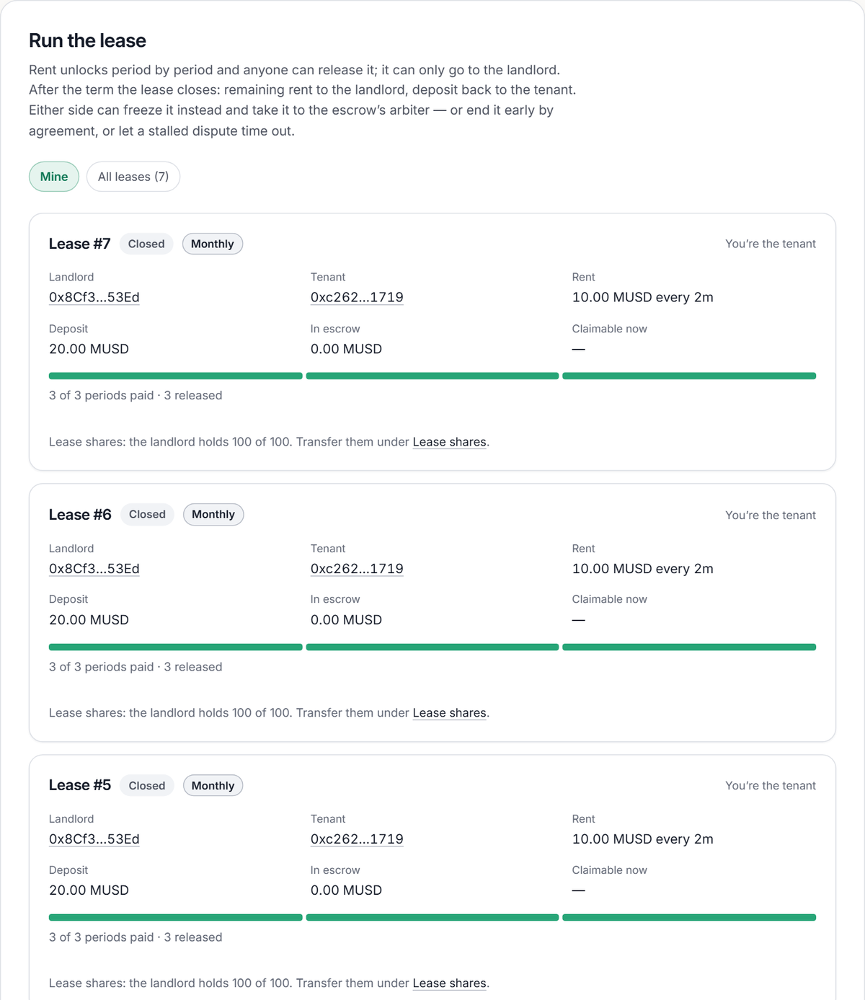 |

| Borrow MUSD against BTC | Phone |
|---|---|
| 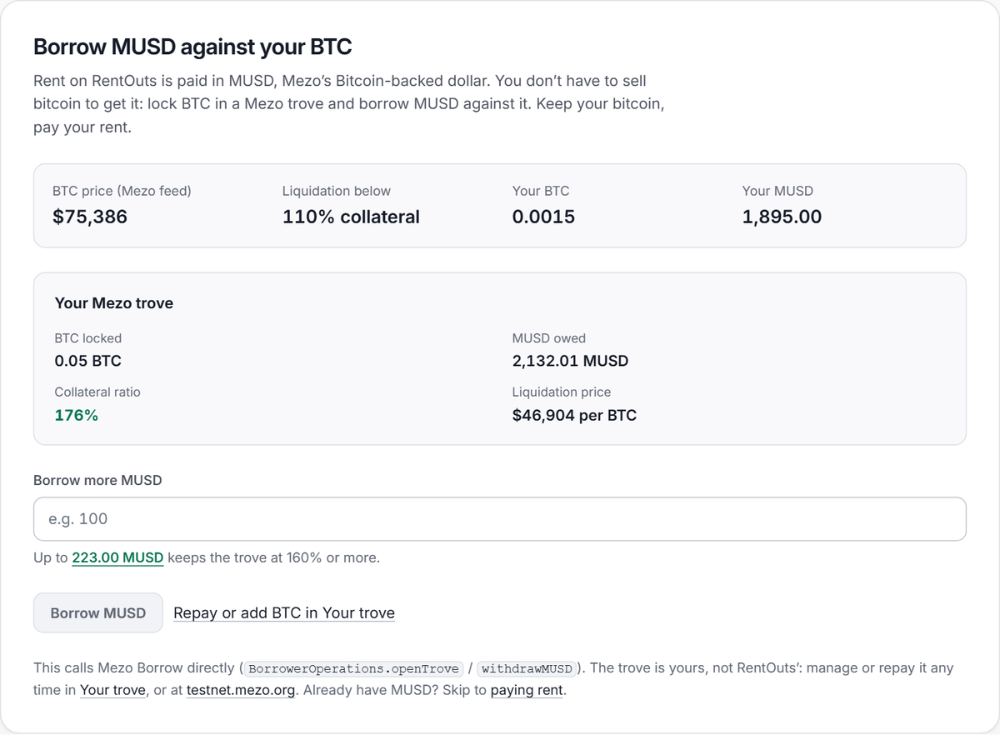 | 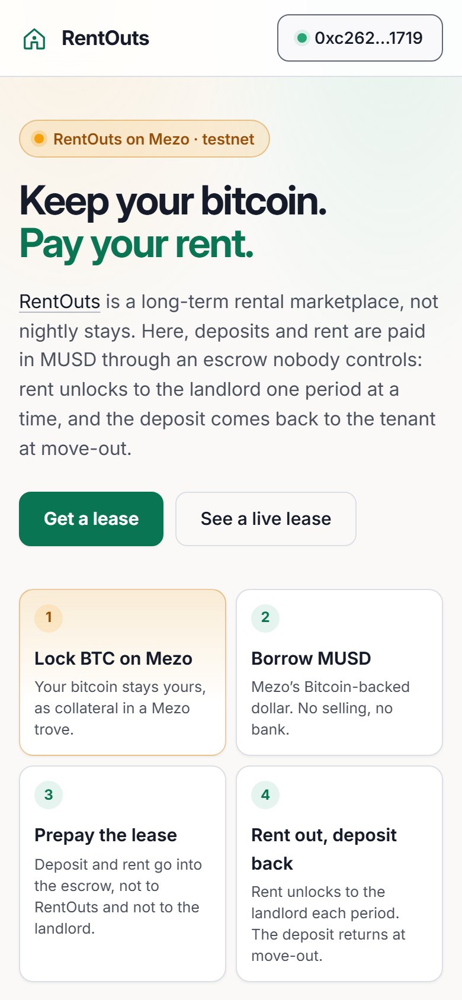 |

## Contracts and live evidence

All on Mezo testnet (chain 31611), verified on Sourcify (exact match).

| Contract | Address | Role |
|---|---|---|
| RentEscrowV2 (live) | [`0xE9c9230DE785504c7D383EfEC46cfCa328e257e4`](https://explorer.test.mezo.org/address/0xE9c9230DE785504c7D383EfEC46cfCa328e257e4) | The escrow the app drives: prepaid or monthly, borrow-and-pay, early termination, dispute timeout |
| LeaseShare1155 | [`0x4E55dD9d8A41C0CCF21C1FCF70d63A1c4453089E`](https://explorer.test.mezo.org/address/0x4E55dD9d8A41C0CCF21C1FCF70d63A1c4453089E) | Wave-2 lease shares (100 per lease, compliance allowlist) |
| DemoLandlordV2 | [`0x8Cf3F01E8ec43791758768d72993D192A87653Ed`](https://explorer.test.mezo.org/address/0x8Cf3F01E8ec43791758768d72993D192A87653Ed) | Rents to anyone on RentEscrowV2: 20 MUSD deposit, 10 MUSD / 120 s × 3, prepaid or monthly |
| HumanGate | `0x00dBe18F1c6Db528006f9b1f34dD7175b3a40015` | Proof-of-personhood seam for funding; open on testnet (no verifier set), so every wallet can fund |
| BorrowerOperationsSignatures (Mezo) | `0xD757e3646AF370b15f32EB557F0F8380Df7D639e` | The relay the escrow calls for one-transaction borrow-and-pay |
| Arbiter | `0x1da334A5FaB59a741fDAE7f081c7f592027b3106` | Can only split a disputed lease between its two parties |
| MUSD (Mezo) | `0x118917a40FAF1CD7a13dB0Ef56C86De7973Ac503` | Settlement token, 18 decimals |
| BorrowerOperations (Mezo) | `0xCdF7028ceAB81fA0C6971208e83fa7872994beE5` | `openTrove` / `withdrawMUSD` |
| RentEscrow (Wave 1) | [`0xA9f09366991E6df87855F4B99025911790d4C3aF`](https://explorer.test.mezo.org/address/0xA9f09366991E6df87855F4B99025911790d4C3aF) | The Wave-1 escrow; its leases stay readable in the app |
| LeaseShare1155 (Wave 1) | [`0xfE8bF13ed62A473277d841b0DEDf7720C3DBc820`](https://explorer.test.mezo.org/address/0xfE8bF13ed62A473277d841b0DEDf7720C3DBc820) | Wave-1 lease shares |
| DemoLandlord (Wave 1) | [`0x6621dE90776302aD1a3C0190141f9169B4A0112B`](https://explorer.test.mezo.org/address/0x6621dE90776302aD1a3C0190141f9169B4A0112B) | Wave-1 demo landlord: 20 MUSD deposit, 10 MUSD / 60 s × 3 |

**Lease #6 — the full flow, run during Wave 1** (demo lease → borrow in-app → pay → release → close):

| Step | Tx |
|---|---|
| DemoLandlord.requestLease | [`0x5d250a56…6c4e`](https://explorer.test.mezo.org/tx/0x5d250a56d0df12add7416852a1f8a5b8862f093cc1a2caf67ac5f77765ed6c4e) |
| BorrowerOperations.withdrawMUSD | [`0x20654b72…c97c`](https://explorer.test.mezo.org/tx/0x20654b722b6c333a59cabe5ca19f772753152c946043f619d5609638204ec97c) |
| MUSD.approve | [`0x2efcf493…d4f9`](https://explorer.test.mezo.org/tx/0x2efcf493db6717f081054bf22406d3c412875c522fece6488895a9f858ecd4f9) |
| RentEscrow.fundLease | [`0xed3097f3…28aa`](https://explorer.test.mezo.org/tx/0xed3097f36a3898811192d5f0f5f6220b5d95b75eaa66918ef13491508c1c28aa) |
| RentEscrow.claimRent | [`0x6a684a83…a021`](https://explorer.test.mezo.org/tx/0x6a684a831177a4bef4d524e68d63fcb5e2c67c3102e38b40d44d2b61c35da021) |
| RentEscrow.closeLease | [`0xc462a321…ae77`](https://explorer.test.mezo.org/tx/0xc462a3219e08f85912ebe0a0a334eca7cc6a1f5edb9788138d99aebfe85cae77) |

**Lease #1 (Wave 1)** — first MUSD lease, minted through `openTrove` (2,000 MUSD on 0.045 BTC): [`openTrove`](https://explorer.test.mezo.org/tx/0x037283b2380752c8ce1c58df1a11ebd0e2a3c8b8ca3316d2b50905ef5466917b) · [`createLease`](https://explorer.test.mezo.org/tx/0x5c8199923d447762e3328682c0018834a393ba369b8932d6b513f751184a92ed) · [`fundLease`](https://explorer.test.mezo.org/tx/0x3bd42097117b0277f2d44e90bcc07ab757c0c1e5c0d95fbd49995602eaa89690) · [`claimRent`](https://explorer.test.mezo.org/tx/0xe3dddf8d66a9a19c3fe675b2ce524a230a33c34b951409ea6394645db63302ef) · [`closeLease`](https://explorer.test.mezo.org/tx/0x0ca9fcd7661273512c8fffd0a708d51a817a0fe6878e4ef4396c62eb1cb71c87)

**Lease #2 (Wave 1)** — ran through Wave 1 judging, then closed at term: 100 MUSD deposit, 50 MUSD / day × 14, 800 MUSD prepaid ([`createLease`](https://explorer.test.mezo.org/tx/0x2f0dd40f50ad94a28935af4acdc7802d59fd28bfa3df51a1d1d40a960ce7c9f7) · [`fundLease`](https://explorer.test.mezo.org/tx/0xd1d5088b7956bee94ce8ca5bc85a38ff4e63fcb3e5c0bca00b0f7ba00b116532) · [`closeLease`](https://explorer.test.mezo.org/tx/0x8385b4390950b72c70d20672c8e442d1fba12f9439bc068cddc9ec88a48dd2b6): 600 MUSD rent to the landlord, the 100 MUSD deposit back).

Full transaction log: [docs/MEZO-DEMO.md](docs/MEZO-DEMO.md).

## Leases on Mezo

The team’s demo leases so far, each with the transactions that prove it; [docs/MEZO-DEMO.md](docs/MEZO-DEMO.md) has the full log. The hosted app reads both escrows, so the Wave-1 leases still show under **Run the lease**.

| Escrow | Lease | Kind | Landlord | Tenant | Status | Proof |
|---|---|---|---|---|---|---|
| [RentEscrow · Wave 1](https://explorer.test.mezo.org/address/0xA9f09366991E6df87855F4B99025911790d4C3aF) | #1 | prepaid · team | [`0xca46BC…33C6`](https://explorer.test.mezo.org/address/0xca46BC7646fD202F0E20e0c8CE16093A3C4D33C6) | [`0x61e6E2…dce1`](https://explorer.test.mezo.org/address/0x61e6E29C48878142E25d8BeBdaDe3e584FCDdce1) | Closed | [fund](https://explorer.test.mezo.org/tx/0x3bd42097117b0277f2d44e90bcc07ab757c0c1e5c0d95fbd49995602eaa89690) · [claim](https://explorer.test.mezo.org/tx/0xe3dddf8d66a9a19c3fe675b2ce524a230a33c34b951409ea6394645db63302ef) · [close](https://explorer.test.mezo.org/tx/0x0ca9fcd7661273512c8fffd0a708d51a817a0fe6878e4ef4396c62eb1cb71c87) |
| [RentEscrow · Wave 1](https://explorer.test.mezo.org/address/0xA9f09366991E6df87855F4B99025911790d4C3aF) | #2 | prepaid · team | [`0xca46BC…33C6`](https://explorer.test.mezo.org/address/0xca46BC7646fD202F0E20e0c8CE16093A3C4D33C6) | [`0x61e6E2…dce1`](https://explorer.test.mezo.org/address/0x61e6E29C48878142E25d8BeBdaDe3e584FCDdce1) | Closed: ran through Wave 1 judging, deposit back | [create](https://explorer.test.mezo.org/tx/0x2f0dd40f50ad94a28935af4acdc7802d59fd28bfa3df51a1d1d40a960ce7c9f7) · [fund](https://explorer.test.mezo.org/tx/0xd1d5088b7956bee94ce8ca5bc85a38ff4e63fcb3e5c0bca00b0f7ba00b116532) · [close](https://explorer.test.mezo.org/tx/0x8385b4390950b72c70d20672c8e442d1fba12f9439bc068cddc9ec88a48dd2b6) |
| [RentEscrowV2](https://explorer.test.mezo.org/address/0xE9c9230DE785504c7D383EfEC46cfCa328e257e4) | #1 | monthly · team | DemoLandlordV2 [`0x8Cf3F0…53Ed`](https://explorer.test.mezo.org/address/0x8Cf3F01E8ec43791758768d72993D192A87653Ed) | [`0xca46BC…33C6`](https://explorer.test.mezo.org/address/0xca46BC7646fD202F0E20e0c8CE16093A3C4D33C6) | Closed | [fund](https://explorer.test.mezo.org/tx/0xc9999b35b0f8562c9c208052ad21835efa1e1a29870c62c8f7711a215b420c76) · [pay](https://explorer.test.mezo.org/tx/0x2c0c852045df9a57a08863e4023bd675f9f25cccf8fec9ee048fb25fc4c029e3) · [close](https://explorer.test.mezo.org/tx/0x351e388cf96457804b77299351441ebfc61f0a9877ac00414d927f4285c33b1a) |
| [RentEscrowV2](https://explorer.test.mezo.org/address/0xE9c9230DE785504c7D383EfEC46cfCa328e257e4) | #2 | prepaid · team | [`0xca46BC…33C6`](https://explorer.test.mezo.org/address/0xca46BC7646fD202F0E20e0c8CE16093A3C4D33C6) | [`0xc262d3…1719`](https://explorer.test.mezo.org/address/0xc262d36287DBe2Eda5cb3D776F9e527E24b51719) | Closed: early end by agreement | [fund](https://explorer.test.mezo.org/tx/0xb71167f14c0d61d0bed15c904643d3b7cd7358e06ccbae2c4c77dfbdefe60c99) · [propose](https://explorer.test.mezo.org/tx/0x9829ceb4957dc5912d438a6dc5b4a9049ab1aaf63a212b56d9d0538ea4344610) · [accept](https://explorer.test.mezo.org/tx/0x6dd34072ffb524cec337ba31bfe57ad0d63ac4bef4c62f644e639e0d089a8a6b) |
| [RentEscrowV2](https://explorer.test.mezo.org/address/0xE9c9230DE785504c7D383EfEC46cfCa328e257e4) | #3 | prepaid · team | [`0xca46BC…33C6`](https://explorer.test.mezo.org/address/0xca46BC7646fD202F0E20e0c8CE16093A3C4D33C6) | [`0xc262d3…1719`](https://explorer.test.mezo.org/address/0xc262d36287DBe2Eda5cb3D776F9e527E24b51719) | Closed: dispute settled by timeout | [fund](https://explorer.test.mezo.org/tx/0xcb2e17c5d16c357a9e3e04ddbb078be57b2f33c56a04f218c9c6466acc66ab90) · [dispute](https://explorer.test.mezo.org/tx/0x07f90cae834b188f4ae7abefe04daf88af229899bd5580a88df57a7f4f037171) · [timeout](https://explorer.test.mezo.org/tx/0xc65836935d3a1c9c1dd9cca945d3ff129751e8845650e9e2d0180e886987d487) |
| [RentEscrowV2](https://explorer.test.mezo.org/address/0xE9c9230DE785504c7D383EfEC46cfCa328e257e4) | #4 | prepaid · team | [`0xca46BC…33C6`](https://explorer.test.mezo.org/address/0xca46BC7646fD202F0E20e0c8CE16093A3C4D33C6) | [`0xc262d3…1719`](https://explorer.test.mezo.org/address/0xc262d36287DBe2Eda5cb3D776F9e527E24b51719) | Closed: opened by a fresh wallet’s one-transaction borrow-and-pay, deposit back | [create](https://explorer.test.mezo.org/tx/0xbed9121ba99fd5b2b62fc261d0e19b306d2bd8f8eb4a16e7869176ef30ad78cd) · [borrowAndFund](https://explorer.test.mezo.org/tx/0xc3a379e0a40e2934ad61bccb1c6eed89c084310fb79a0cb2243bce12c1d20d8e) · [close](https://explorer.test.mezo.org/tx/0x8780524e609bb321a4d46ee98cfe866f4c040284e0ff960ae6c3cd79da220e50) |

| [RentEscrowV2](https://explorer.test.mezo.org/address/0xE9c9230DE785504c7D383EfEC46cfCa328e257e4) | #5 | monthly · team | DemoLandlordV2 [`0x8Cf3F0…53Ed`](https://explorer.test.mezo.org/address/0x8Cf3F01E8ec43791758768d72993D192A87653Ed) | [`0xc262d3…1719`](https://explorer.test.mezo.org/address/0xc262d36287DBe2Eda5cb3D776F9e527E24b51719) | Closed: deposit + first month minted from the trove, later months from the wallet, deposit back | [withdrawAndFund](https://explorer.test.mezo.org/tx/0xdfbda55d17568511ea6707b5f875b5c6659c1bf4d6ff6835eb7fe0413a97e7ca) · [payRent](https://explorer.test.mezo.org/tx/0x46819970d548dc9ddef62982417640fb3e9bb6ad9706a707b25537fbc9ac291a) · [close](https://explorer.test.mezo.org/tx/0x26b8288e5533047c43709351d56cc6c956b5d25f0a68ee4276b3cc31ee32ce85) |
| [RentEscrowV2](https://explorer.test.mezo.org/address/0xE9c9230DE785504c7D383EfEC46cfCa328e257e4) | #6 | monthly · team | DemoLandlordV2 [`0x8Cf3F0…53Ed`](https://explorer.test.mezo.org/address/0x8Cf3F01E8ec43791758768d72993D192A87653Ed) | [`0xc262d3…1719`](https://explorer.test.mezo.org/address/0xc262d36287DBe2Eda5cb3D776F9e527E24b51719) | Closed: every month minted from the trove, deposit back | [withdrawAndFund](https://explorer.test.mezo.org/tx/0x0bb483cbdf4e457bbe08dd0eab7f8ad19a881becc83d88fdf9bfb89f7105840d) · [withdrawAndPayRent](https://explorer.test.mezo.org/tx/0x0bf84e97b6b8ddacde0382efad763f06dd15cd637f9c1cce6a915bfa6ad5ca85) · [withdrawAndPayRent](https://explorer.test.mezo.org/tx/0x351578d24c85dd85b369e103bab7e18d220c76419ad204190bb6d9c6b8176c9d) · [close](https://explorer.test.mezo.org/tx/0x1cfa2822f92b5e0198b9510b6d56ea0272e31f41029b9c9ee5b3c2d83944ff0d) |
| [RentEscrowV2](https://explorer.test.mezo.org/address/0xE9c9230DE785504c7D383EfEC46cfCa328e257e4) | #7 | monthly · team | DemoLandlordV2 [`0x8Cf3F0…53Ed`](https://explorer.test.mezo.org/address/0x8Cf3F01E8ec43791758768d72993D192A87653Ed) | [`0xc262d3…1719`](https://explorer.test.mezo.org/address/0xc262d36287DBe2Eda5cb3D776F9e527E24b51719) | Closed: the Wave 2 demo video run, every month minted from the trove, deposit back | [withdrawAndFund](https://explorer.test.mezo.org/tx/0x326f39d72eaba9555e234c53097c49168c0e34fac78e22d3e25be6db774265bd) · [withdrawAndPayRent](https://explorer.test.mezo.org/tx/0xc2f5cb36f1a84bd07981ef481f477ec3d3052ee7d87b05e8312bded514275bed) · [withdrawAndPayRent](https://explorer.test.mezo.org/tx/0x75dd6b9d8ddcd20cc0f252737a7332636aa9a8f10e1c20f19e92e5ba85b8a98f) · [close](https://explorer.test.mezo.org/tx/0x278f730bc6c91501f033d50ba7f776b60d8c46b898f24e0f746818f8e1299ae1) |
<!-- leases-table: add rows above -->

The nine leases above are the team’s demos. Non-team leases are added here as they land.

## Security model

- **No owner, no admin, no fee, no upgrade path.** Token, arbiter, lease-share contract, borrow relay, human gate and dispute timeout are immutable constructor arguments.
- **Funds only ever reach the lease’s two parties.** The arbiter cannot be a landlord or tenant and can only split a disputed lease’s own remaining escrow. MUSD that reaches the escrow without a lease (a front-run signature) is unbooked: no lease can touch it, and the arbiter can only return it to the address that paid it in.
- **Invariants, fuzzed** (`test/RentEscrow.invariant.t.sol` and `test/RentEscrowV2.invariant.t.sol`, 64 runs × depth 256, revert = failure):
  - INV-1 funds only ever move to the lease’s tenant or landlord;
  - INV-2 the sum of every lease’s escrow balance equals the escrow’s MUSD balance;
  - INV-3 rent released never exceeds rent per period × elapsed periods (capped at the term);
  - INV-4 a settlement pays out exactly the lease’s remaining escrow;
  - and the V2 suite adds: each lease’s balance is exactly its remaining terms (deposit plus funded, unclaimed rent), a lease only counts as funded with at least the MUSD its terms require, the escrow’s balance never drops below what its leases are owed, and no lease ever pays out more than it took in.
- **Rent can’t be taken early or withheld.** `claimRent` releases only elapsed (and, on monthly, funded) periods, and anyone may call it, but the MUSD only goes to the landlord.
- **No holdout ending.** Either party can propose an early end the other can accept; a dispute the arbiter never rules on can be settled by anyone after the timeout (600 s on testnet) with a fixed split; a monthly lease the tenant stops paying is closed by `claimDefault`, which can reach at most one unpaid period’s rent.
- **The app holds no keys.** It is a static site; every transaction is signed in the user’s wallet, simulated first so reverts show as readable messages.

## Limitations

**Getting MUSD takes real BTC.** Mezo’s minimum trove is 1,800 MUSD (plus a 0.1% fee and a 200 MUSD gas reserve that comes back when the trove closes). At about $81k per BTC that needs roughly 0.037 BTC at 150% and 0.049 BTC at 200%: about $3,000–4,000 of BTC, even for a small lease. Mezo’s testnet faucet gives 0.05 BTC, which the app sizes for. Mezo charges 1% a year on the trove. Borrow-and-pay merges the steps; it does not shrink the minimum. Already holding MUSD skips all of this.

**The deposit is still posted up front; the rent need not be.** A landlord can list the lease as monthly: the tenant funds the deposit plus the first period, then pays each further period from their own trove (or an MUSD balance). If a period goes unpaid one full period past its due date, the landlord’s `claimDefault` closes the lease: the landlord keeps the funded rent not yet claimed plus at most one unpaid period’s rent taken from the deposit, and the tenant gets the rest of the deposit back. A *prepaid* lease still ties up every period’s rent for the whole term (a 12-month, $2,000 lease means 26,000 MUSD up front, about 0.64 BTC at 200%).

**The tenant carries the BTC price risk, the landlord does not.** The BTC is in the tenant’s own Mezo trove, not in the escrow: RentOuts and the landlord cannot touch it, and the tenant can repay and withdraw it at any time. What protects the landlord is the MUSD already in escrow. If BTC falls far enough, the tenant’s trove can be liquidated or redeemed against, but the lease keeps paying the landlord.

**Ending a lease early needs agreement, a ruling, or the clock.** Both parties can settle an early end themselves: one proposes a split with an agreed penalty to the landlord, the other accepts, and the lease closes with no third party involved. Without agreement it goes through a dispute, which freezes what is left in escrow until it is split; rent already released stays released, and damage beyond what is left in escrow is not covered on-chain. The arbiter must stay available while a dispute is open (one key on testnet; a multisig is planned), but a dispute they never rule on can be settled by anyone after the timeout, with a fixed split: 600 seconds on testnet, 30 days planned for production.

**Deposits sit idle in the escrow, and that is a choice for now.** Idle MUSD in escrow earns nothing. The obvious idea, Mezo’s Stability Pool, pays BTC gains from liquidations and takes MUSD losses, and locks withdrawals while any trove in the system is undercollateralized. We fact-checked the protocol source before treating it as an option: [docs/STABILITY-POOL-CHECK.md](docs/STABILITY-POOL-CHECK.md). Not for now: that is the wrong risk for a deposit the tenant must get back in full, so for Wave 2 deposits stay in the escrow and pay-monthly keeps prepaid MUSD from piling up instead.

**Local rules on deposits and prepaid rent vary.** Some jurisdictions cap deposits or prepaid rent, or require deposits held in trust with interest. A production lease has to fit the local rules; this testnet escrow does not check them.

**Testnet, not audited.** No real funds, no external audit yet. The demo landlords exist only so one wallet can try the tenant side.

## Business model

The escrow itself never charges: it is deployed immutable, with no owner, no admin key and no fee to switch on later, on testnet and in production. Revenue comes from the [rentouts.co portals](https://rentouts.co), not from the chain: when MUSD becomes a payment option there, landlords pay **1% of rent**, off-chain, alongside the portal’s listing and management service. Tenants pay nothing extra, and nobody pays twice. Nothing charges anything today: the fee arrives with the portal integration planned for Q1 2027. The full model, a worked example and what we will not do: [docs/REVENUE-MODEL.md](docs/REVENUE-MODEL.md).

## RentEscrowV2 (Wave 2)

`RentEscrowV2` (`src/RentEscrowV2.sol`) is the Wave-2 escrow and the one the hosted app drives: the deployed V1 behaviour unchanged, plus all four items of the Wave-2 row — borrow-and-fund in one transaction, mutual early termination, a dispute timeout, and pay-monthly funding drawn from the tenant's Mezo trove. The pay-monthly build is deployed on Mezo testnet at [`0xE9c9230DE785504c7D383EfEC46cfCa328e257e4`](https://explorer.test.mezo.org/address/0xE9c9230DE785504c7D383EfEC46cfCa328e257e4) with DemoLandlordV2 [`0x8Cf3F01E8ec43791758768d72993D192A87653Ed`](https://explorer.test.mezo.org/address/0x8Cf3F01E8ec43791758768d72993D192A87653Ed) (all Sourcify exact match; dispute timeout 600 s for the demo), recorded under `mezoTestnetV2` in `deployments.json`. A real monthly lease, paid month by month from the tenant's own trove, is logged in [docs/MEZO-DEMO.md](docs/MEZO-DEMO.md#wave-2--a-pay-monthly-lease-paid-from-the-tenants-own-trove-closed). The first, prepaid-only V2 deploy (`0xdD4A…113e`) is kept as `mezoTestnetV2Prepaid`.

**Borrow-and-fund in one transaction — `borrowAndFund` / `withdrawAndFund`.** A tenant with BTC but no MUSD signs one Mezo `OpenTrove` (or `WithdrawMUSD`) EIP-712 message naming the escrow as recipient; a single call opens — or draws on — the tenant's own trove and funds the lease with the minted MUSD, refunding any surplus in the same transaction. *Trust model:* the escrow never holds the BTC — `msg.value` goes straight into the tenant's trove, which only the tenant's signature can move; the MUSD received is measured as a balance delta (never taken from the signed numbers), and anything short of deposit + all rent reverts the whole transaction. The relay itself is Mezo's `BorrowerOperationsSignatures`; configuring `address(0)` disables both paths.

**Front-running.** Mezo's relay does not restrict who submits a signature, so a watcher can copy a tenant's pending signature and relay it directly with recipient = the escrow: the tenant's nonce is spent and their trove debt grows, but no lease is booked, and the tenant's own call then reverts. Nothing is stranded: the tenant can always fall back to `fundLease` (or sign a fresh operation), the minted MUSD shows up in `unbookedBalance()` — the balance beyond `totalEscrowed`, which no lease can ever touch — and the arbiter returns it with `returnUnbooked` to whoever the Mezo event logs show it belongs to. For the same reason the escrow accepts only value-zero BTC transfers (`StrayBtc` otherwise): Mezo's trove code always settles the caller's collateral delta with one, and any real BTC would have no way out.

**Mutual early termination — `proposeTermination` / `withdrawTermination` / `acceptTermination`.** Either party proposes a split (a penalty to the landlord), the other accepts before the terms expire; earned-but-unclaimed rent always goes to the landlord, the penalty comes out of the tenant's side, the tenant gets the rest, and the lease closes. *Trust model:* no third party is involved — nothing settles unless both parties signed the exact terms (a hash of lease, proposer, penalty, expiry); the penalty is bounded by the tenant's remaining side at propose and re-checked at accept; either party can withdraw its proposal at any time before acceptance; a new proposal replaces the old one.

**Dispute timeout — `resolveByTimeout`.** A dispute frozen for `disputeTimeout` (immutable, 30 days by default) can be settled by anyone: the landlord takes the rent earned up to the dispute, the tenant the rest. *Trust model:* the arbiter's power is unchanged while it acts in time; after the timeout nobody can hold the funds hostage, because the split is mechanical, from data the contract already keeps. Whichever resolution comes first — arbiter ruling or timeout — wins.

**Pay monthly from your trove — `createLeaseMonthly` / `payRent` / `withdrawAndPayRent` / `claimDefault`.** A landlord may create the lease as *monthly*: funding covers the deposit plus **one** period's rent, and each month the tenant signs a single Mezo `WithdrawMUSD` message while `withdrawAndPayRent` draws that month's rent straight from the tenant's trove into the escrow — rent paid from your bitcoin, month by month, without selling it (`payRent` does the same from a plain MUSD balance and approval). The term, the clock and the period-by-period release are the prepaid lease's; rent is only ever released for periods that were actually funded, and every settlement (dispute ruling, timeout, mutual termination, close) splits exactly what the lease holds: `deposit + (funded − claimed) × rent`. *Default rule:* period *i* (0-based) is due at `startTime + i × periodSeconds`; if an unfunded period runs one full period — the grace — past its due date, the landlord may call `claimDefault`: the landlord takes the funded-but-unclaimed rent plus **at most one unpaid period's rent out of the deposit** (capped at the deposit), the tenant gets the rest of the deposit, and the lease closes with `leasesDefaulted` on the tenant's record. *Trust model:* the escrow never holds or moves the BTC — the trove stays the tenant's own, drawn on only by the tenant's signature naming the escrow as recipient; the MUSD received is measured as a balance delta (never the signed numbers) with any surplus refunded in the same transaction; and no party can reach unfunded rent — the deposit forfeit is capped mechanically at one period's rent, so a tenant who paid deposit + *n* periods can never lose more than one period they did not pay.

`test/RentEscrowV2.fork.t.sol` proves the borrow path against real testnet state at a pinned block: one transaction opens the tenant's trove and funds the lease, the recipient receives exactly `debtAmount`, and the surplus comes back to the tenant — and the monthly path does it twice: the same call funds a monthly lease with deposit + one period, then a fresh `WithdrawMUSD` signature pays the next period from the same trove, with the debt growing by the rent.

## Roadmap

| When | Milestone |
|---|---|
| **Wave 2 · Nov 2026 · shipped** | ✅ Borrow-and-pay in one transaction · pay monthly from the tenant’s trove · mutual early termination · a dispute timeout · the **Your trove** panel in the app |
| **Wave 3** | Real tenants and landlords on testnet · landlord self-serve allowlist |
| **Q1 2027** | MUSD as a payment option in the rentouts.co owner and renter portals for invite-only beta leases |
| **Q2 2027** | External audit, Mezo mainnet launch, multisig arbiter |

## Repository map

```
rentouts-musd/
├── src/
│   ├── RentEscrow.sol          escrow: create · fund · claimRent · close · dispute
│   ├── RentEscrowV2.sol        Wave-2 escrow: borrow-and-fund · termination · timeout · monthly
│   ├── LeaseShare1155.sol      ERC-1155 lease shares with a compliance allowlist
│   ├── DemoLandlord.sol        a landlord anyone can rent from (one-wallet demo)
│   ├── DemoLandlordV2.sol      the same for the Wave-2 escrow, prepaid or monthly
│   ├── HumanGate.sol           optional "verified human" gate for funding (wired into V2; open until a verifier is set)
│   └── interfaces/             IRentEscrow, IRentEscrowV2 (lifecycle + invariants), IHumanGate
├── test/                       194 Foundry tests, incl. both invariant suites
├── script/                     DeployEscrow(V2).s.sol, DeployDemoLandlord(V2).s.sol
├── deployments.json            live addresses ("mezoTestnet", "mezoTestnetV2")
├── .mezo/                      Mezo protocol ABIs + a raw eth_call helper
├── app/                        the web app (React 19, Vite, wagmi + viem)
│   └── src/
│       ├── panels/             Get a lease · Borrow · Pay · Run · Your trove · Lease shares
│       ├── lib/trove.ts        Mezo Borrow math (ratio, collateral, liquidation, sizing)
│       └── abi/mezo.ts         Mezo Borrow ABIs and addresses
└── docs/                       MEZO-DEMO.md (tx log), img/ (screenshots)
```

## Build, test, deploy

Contracts ([Foundry](https://book.getfoundry.sh/)):

```bash
forge install
forge test                     # 194 tests, including both invariant suites
```

App:

```bash
cd app
npm install
npm test                       # 163 tests: trove math, receipts, deployments, copy
npm run dev                    # http://localhost:5173 (Mezo testnet by default)
npm run build                  # static output in app/dist
```

Deploy the escrow with a Foundry keystore (never a raw private key):

```bash
ESCROW_TOKEN=0x118917a40FAF1CD7a13dB0Ef56C86De7973Ac503 \
ESCROW_ARBITER=<arbiter-address> \
ESCROW_HUMAN_GATE=none \
forge script script/DeployEscrow.s.sol --profile mezo --rpc-url mezo_testnet \
  --account <keystore-name> --sender <deployer-address> --broadcast
```

`ESCROW_HUMAN_GATE=none` leaves funding ungated on this escrow (a gate cannot be added later). A successful broadcast adds a `mezoTestnet` entry to `deployments.json`; the `baseSepolia` key in that file is a placeholder used by the script’s tests, not a live deployment.

The Wave-2 escrow deploys the same way: `script/DeployEscrowV2.s.sol` takes the dispute timeout and borrow relay as inputs and records the `mezoTestnetV2` entry on broadcast.

Deploy the demo landlord, then allowlist it on LeaseShare1155 once (creating a lease mints its shares to the landlord):

```bash
ESCROW=<RentEscrow address> forge script script/DeployDemoLandlord.s.sol --profile mezo --rpc-url mezo_testnet \
  --account <keystore-name> --sender <deployer-address> --broadcast
# then, as the LeaseShare1155 owner: setAllowlist(<DemoLandlord>, true)
```

For the Wave-2 demo landlord, `script/DeployDemoLandlordV2.s.sol` (env `ESCROW=<RentEscrowV2 address>`, optional `DEMO_DEPOSIT` / `DEMO_RENT` / `DEMO_PERIOD` / `DEMO_PERIODS`; defaults 20 / 10 MUSD, 120 s, 3 periods) allowlists itself on the share contract when the broadcaster owns it.

The app is a static build served by a Cloudflare Worker (`app/wrangler.jsonc`); it reads every address from `deployments.json` at build time and holds no secrets.

## License

MIT. OpenZeppelin Contracts v5.1.0 is included as a library under its own license.
